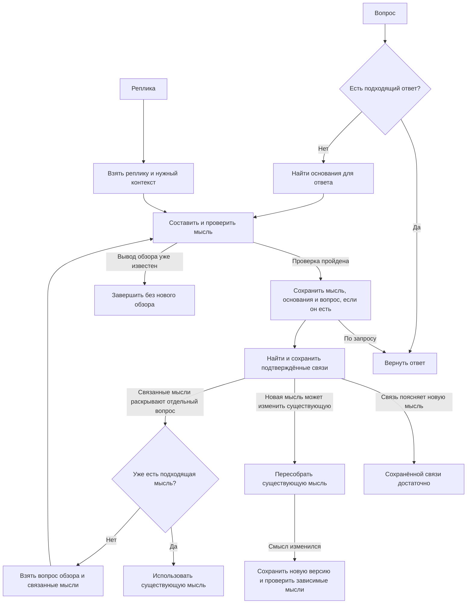

# Память утверждений

Самостоятельная память через MCP: SQLite хранит исходные сообщения, происхождение, граф знаний и неизменяемые версии ответов. Содержательная единица новой системы — мысль (`thought`): связное содержание с основаниями. Тематические обзоры и ответы на вопросы строятся тем же механизмом; мысли могут опираться на другие мысли. Исходные сообщения, сессии и служебный учёт хранятся отдельно.

Это исследовательская реализация. Публикация исходников не означает готовность к производственной эксплуатации. Смысловая проверка и восстановление после технических сбоев ограничены; исчерпание попыток остаётся видимым сбоем и не выдаётся за отсутствие фактов. Сохранённая квитанция сообщения не подтверждает завершение извлечения или корректность ответа.

## От реплики или вопроса к связям и обзорам



Разбор связей сохраняет отношения между точными версиями мыслей до постановки обновлений. Пересборка проверяет, изменился ли ответ. Повторная проверка зависимых мыслей запускается при изменении смысла.

Автоматический обзор использует общие шаги составления, проверки и публикации. Проверка сравнивает вывод с известными соседними мыслями. Перефразировка существующего вывода завершает обработку без новой записи. Те же основания могут дать самостоятельный вывод на другой вопрос.

## Pausing and cancelling the canonical background worker

Send SIGINT or SIGTERM to the owned worker PID to stop claiming jobs and let
active jobs save their results. SIGUSR1 requests cancellation instead. The
worker terminates only model subprocess groups it started and returns affected
jobs to the queue with their completed checkpoints. A remote HTTP provider may
still take until its response or timeout. The configured processing selection
controls whether later intake may start another worker.

## Разовый прогон реплики на Mac

На хосте с базой команда обрабатывает самое раннее ожидающее сообщение указанной
сессии и её собственные задания по связям, обзорам и обновлениям. Дата отправки
используется при наличии, иначе применяется время сохранения. Прерванный прогон
при следующем запуске продолжает ту же реплику. Задание, объединённое с более
ранней работой, показывается в отчёте как заблокированное и остаётся в очереди.

```sh
python3 -m prototypes.assertion_memory.process_one_host --server-dir SERVER_DIR --check
python3 -m prototypes.assertion_memory.process_one_host --server-dir SERVER_DIR SESSION_ID
```

Используйте Python из окружения сервера. Команда требует паузу фоновой обработки.
Она выводит один JSON-отчёт с изменёнными мыслями, связями и расходом модели.
Для проверки настроек `--check` не вызывает модель и не обрабатывает очередь.

## Запуск MCP

Нужны Python 3.10+, SQLite с FTS5 и зависимости из `requirements-mcp.txt`. Команды выполняются из корня репозитория. Создайте отдельное окружение:

```sh
python3 -m venv prototypes/assertion_memory/.local/runtime
prototypes/assertion_memory/.local/runtime/bin/python -m pip install \
  -r prototypes/assertion_memory/requirements-mcp.txt
prototypes/assertion_memory/.local/runtime/bin/python \
  -m prototypes.assertion_memory.mcp_server \
  --db /absolute/private/memory.sqlite3 \
  --provider codex --model gpt-6.1-terra \
  --review-model gpt-6.2-sol --reasoning-effort low
```

Подключите эту stdio-команду в MCP-клиенте. При запуске из другой директории задайте `PYTHONPATH` с абсолютным путём к корню репозитория. `codex` должен быть установлен и авторизован отдельно; код использует его существующую авторизацию. Имена моделей в примере — настраиваемый профиль, а не зашитое ограничение системы.

`ServiceConfig` задаёт `provider`, `model`, необязательный `review_model` и `reasoning_effort`. Раздельный `review_model` поддерживается для `codex` и `local`; усилие рассуждения — для `codex`. Проверяющий наследует `reasoning_effort`; поле `review_reasoning_effort` или CLI-флаг `--review-reasoning-effort` переопределяет его только для явно заданного `review_model`. Например, `reasoning_effort="medium"` и `review_reasoning_effort="low"` оставляют проверку на low. Провайдер `subprocess` получает массив аргументов команды, `local` — совместимый endpoint и имя модели. `none` оставляет модельные операции недоступными. Для Codex обычное построение не имеет жёсткого срока выполнения; ограниченный клиентский таймаут не означает отмену сохранённой работы.

Семантический поиск необязателен. Для FastEmbed установите `requirements-runtime.txt` и добавьте `--embedding-mode fastembed --embedding-cache /absolute/private/embedding-models`. Без него используется лексический поиск. Первое использование FastEmbed может скачать веса модели.

### Подключение Codex на отдельном хосте

Оставьте действующий профиль с `provider: "none"`, пока владелец не проверит
учётную запись и доступность Codex в регионе нового хоста. Используйте
официальный Codex CLI и официальный вход владельца под отдельным
непривилегированным системным пользователем сервиса. Храните профиль CLI
в закрытом каталоге этого пользователя; не копируйте cookies, токены или
профиль из другого окружения. Проверка наличия бинарника и статуса входа
не доказывает доступность модели: подтвердите её одним разрешённым запросом
на отдельной временной базе с вымышленным сообщением.

Пример объекта `service` для **выделенной вымышленной** базы. Замените оба
имени модели на те, к которым имеет доступ выбранная учётная запись:

```json
{
  "db": "/absolute/private/synthetic.sqlite3",
  "provider": "codex",
  "model": "OWNER_AUTHORIZED_MODEL",
  "review_model": "OWNER_AUTHORIZED_MODEL",
  "embedding_mode": "lexical",
  "source_workers": 1,
  "codex_job_timeout": 180,
  "processing_session_ids": []
}
```

`codex_job_timeout` ограничивает каждый отдельный вызов модели (включая
проверяющего), а не весь конвейер. Допустим диапазон (0, 600] секунд; при
отсутствии настройки сохраняется прежнее отсутствие лимита Codex. Пустой
`processing_session_ids` отключает автоматический запуск. Для явной проверки
одной новой реплики сохраните её в отдельной тестовой сессии и вызовите
`memory_process` с `limit:1`, `session_ids:[SESSION_ID]` и
`source_event_ids:[EVENT_ID]`. Проверяйте `memory_status` по этому ID.

Известная ошибка запуска, входа, региона или транспорта Codex возвращает
код `model_provider_unavailable` в ошибке ответа или в `error_code`
статуса задания. Это не пустое знание и не результат модели. Ошибка
не раскрывает вывод CLI, не теряет исходник и не переписывает ранее
сохранённые карточки. Такое задание останавливается без автоматического
повтора. После восстановления проверенных условий повторите только нужное
задание в изолированной сессии через `memory_process` с `limit:1`,
`session_ids:[SESSION_ID]`, `retry_job_id:JOB_ID` (без `source_event_ids`).
Убедитесь, что в сессии нет других готовых заданий: лимит ограничивает
очередь сессии, а не меняет порядок обслуживания. Не включайте автоматически
старую очередь рабочих данных.

## Данные и ответы

- `memory_capture_message` сохраняет сообщение с ролью, автором, устойчивыми идентификаторами и происхождением. Повтор с тем же идентификатором должен сохранять неизменное содержание.
- `memory_ingest_register` и `memory_ingest_report` фиксируют наблюдаемую границу доставки производителя. Неизвестные или ещё не доставленные изменения не становятся известными памяти автоматически.
- `memory_query` получает или строит сохранённый ответ с основаниями, условиями, исключениями и известными ограничениями.
- `memory_source` раскрывает исходные сведения и фрагменты; `memory_history` — сохранённые версии и проверки.
- `memory_status` показывает очереди, ошибки и ограничения обработки. В новой системе `thought_repairs` раскрывает учёт восстановления мыслей; эти счётчики не заменяют проверку конкретного ответа.
- `memory_sessions`, `memory_session_messages`, `memory_session_outputs` и инструменты происхождения раскрывают сохранённые сессии и причинные связи.
- `memory_process` запускает штатный обработчик. Параметр `session_ids` выбирает исходные задания указанных сессий и связанные с ними последующие задания только на этот запуск. Например, `{"session_ids":["<session-id>"],"limit":30}`. Пустой список отклоняется. Запуск соблюдает блокировку обработчика и список разрешённых сессий, если он задан и непуст.
- `retry_job_id` повторяет конкретное задание из диагностики. При переданном `session_ids` задание должно относиться к одной из выбранных сессий.
- `batch_source_construction: true` при заданном `session_ids` объединяет первичную генерацию для нескольких реплик, взятых в работу параллельно. Проверка и сохранение выполняются отдельно для каждой реплики. Размер группы ограничен числом обработчиков исходных заданий. Одиночная реплика и исправление после проверки используют обычный вызов модели.
- `source_event_ids` с одним `session_ids` задаёт точную группу ожидающих реплик для одного общего вызова первичной генерации. Укажи `limit` не меньше числа реплик. Их тексты и авторство передаются общей модели без подготовки сводки. Обычная проверка и запись сохраняют отдельные результаты по каждой реплике. Остаток лимита доступен последующим заданиям этой сессии.

Начальный материал составляется один раз: до десяти подходящих мыслей и доступные исходные сообщения из очереди. После этого модель выбирает место в графе и раскрывает его прямые связи по одному уровню за шаг. Повторный смысловой поиск моделью недоступен; общая глубина полезного прохода заранее не ограничена.

Внутренний результат построения ответа или обновления узла содержит одиночный `thought`; извлечение нескольких независимых смыслов из сообщения использует `thoughts[]`. Формат сохранённых мыслей общий. Частичный ответ сохраняет известные факты и прямо называет пробелы в полученных материалах. Если допустимых оснований нет совсем, программа возвращает полный `knowledge_limit_notice` без вызова модели и создания пустой мысли; сообщение не утверждает отсутствие сведений во всей базе.

Диагностика учитывает указанную область. Для незавершённой работы над мыслями доступны отдельные страницы; большие тексты ошибок читаются только на запрошенной странице либо через конкретное задание. Намеренное исключение источника политикой отделено от ошибки обработки.

Оценивайте `answer_accepted`, `completeness`, `source_status` и `freshness_check` отдельно. Принятый текст может описывать неполный набор имеющихся свидетельств. `refresh_required` означает, что ответ относится к датированному срезу: перед действием по текущему состоянию требуется новый запрос. Текущую внешнюю систему проверяют отдельно — память сама её не опрашивает.

Ответы ограничены по объёму. Следуйте всем обязательным `answer_continuations`; для других разделов используйте выданные `continuation` или `continuations`. Продолжение закреплено за сохранённой версией и не должно смешиваться со свежим запросом. Отсутствие сведений, противоречие, неоднозначность и незавершённая обработка имеют разный смысл.

Модель строит и отдельно проверяет интерпретации. Неудачная проверка не разрешает публиковать неподтверждённый текст. Настройка другого генератора или проверяющего сохраняет проверку оснований и историю попыток.

## HTTP-сервис

`http_server` принимает приватный JSON-конфиг с объектом `service` в формате `ServiceConfig`, точным `public_host`, необязательными `additional_hosts` и `port`, а также одним источником bearer-ключа: `token_file` или `token_env_var`. Файл ключа должен принадлежать пользователю сервиса и иметь права `0600`. Переменная окружения должна содержать UUID в каноническом формате. Настоящие конфиги и ключи не входят в репозиторий.

```sh
python -m prototypes.assertion_memory.http_server --config /absolute/private/http.json
```

Сервис слушает только loopback. TLS и внешний доступ настраиваются отдельным прокси; bearer-аутентификация требуется и в приватной сети. База и выбор провайдера принадлежат серверу, клиент не меняет их запросом.

## Захват диалога

Адаптер Codex Desktop необязателен. Основной адаптер репозитория находится в `modules/assertion-memory`; он отделяет доказанный пользовательский ввод и видимые ответы от инструкций и служебных событий.

`native_intake` — отдельный адаптер только для явно разрешённых файлов нативного журнала. Он проверяет физический идентификатор сессии, разрешённый cwd и происхождение ходов. Сам каталог сессий не просматривается:

```sh
PYTHONPATH=/absolute/path/repository python \
  -m prototypes.assertion_memory.native_intake \
  --config /absolute/private/desktop-fast.json \
  --transcript /absolute/private/explicit-session.jsonl
```

Профиль требует `mode: "fast"`, абсолютные `db`, `cwd_roots` и явный `native_session_ids`. `--once` выполняет один проход. Курсор сохраняет границу чтения; замена, усечение или изменение уже прочитанных байтов приводит к явному `IntakeGap`. Окно ограничено 2 МиБ плюс заголовок 64 КиБ: гарантии неограниченного захвата без пропусков нет. Установка хуков и планировщиков выполняется отдельно. Подробности синтетических проверок — в `NATIVE-INTAKE-EVIDENCE.md`.

## Обслуживание и доставка кода

`server_operations` готовит LaunchAgent без регистрации, запуска или остановки сервиса. Используйте абсолютные пути к выбранному релизу, Python, конфигу и отдельному закрытому каталогу журналов:

```sh
python -m prototypes.assertion_memory.server_operations manifest \
  --config /absolute/private/http.json --python /absolute/runtime/bin/python \
  --repository /absolute/repository --log-dir /absolute/private/logs \
  --output-dir /absolute/private/prepared-agents
```

Квитанция возвращает точные plist и label. Адресуйте диагностику и остановку именно этому экземпляру. Пользовательский LaunchAgent зависит от входа пользователя, сна, сети и авторизации. Автоматическая ротация журналов этой командой не устанавливается.

```sh
python -m prototypes.assertion_memory.server_operations backup \
  --source /absolute/private/memory.sqlite3 --backup-dir /absolute/private/backups
python -m prototypes.assertion_memory.server_operations restore \
  --source /absolute/private/backups/memory-TIMESTAMP.sqlite3 \
  --destination /absolute/private/recovered-memory.sqlite3
```

Резервная копия включает зафиксированные WAL-данные и проходит проверку целостности. Необязательный `--ledger-source` копирует отдельный журнал расхода модели; две копии не являются одним глобальным снимком. Восстановление требует нового пути и не переключает действующий сервис. Хранение копий и контроль свободного места настраиваются отдельно.

Доставка проверенного кода, манифесты, атомарное переключение и откат описаны в `MANUAL_RELEASE.md`. Данные, конфиги, окружения, веса и журналы не входят в поставку кода.

## Проверка и прежний CLI

Воспроизводимые проверки и границы приёмки описаны в `VERIFICATION.md`. `WORK_CHECKLIST.md` содержит направления дальнейшей работы, а не заявление о завершённости.

Прежний CLI `python -m prototypes.assertion_memory --help` сохраняет операции с утверждениями, связями и обзорами старого движка. Он полезен для изолированных демонстраций и совместимости; его `ask` не следует считать заменой новому MCP-пути мыслей. Пример вымышленных данных — `tests/fixtures/clone_scenarios.json` внутри этого пакета. Всегда выбирайте отдельную демонстрационную базу через `--db`.

### Trusted source-extractor composition seam

The canonical source extractor stays the default. An in-process trusted host
may pass `claim_bound_source_extractor_factory` to `ThoughtWorker` instead of a
custom regular extractor factory. It receives the active engine and immutable
`SourceExtractionRequest` containing the exact source event, capture and
canonical session IDs, scope, and an attempt-local lease check. The check is
valid only on the connection-owning thread and expires when extraction returns
or fails. It grants no read API, credential, or publication operation.
Configured extractors must return canonically verified drafts; the original
worker still performs guarded publication and durable job completion.

This seam does not enable a continuing model session, register MCP tools, or
load a search backend. A future host integration must bind any ongoing session
to the actual claim, authorize exact history and graph evidence in narrow
read-only tools, and reuse the existing ready semantic service rather than
load another model or index. If the worker and search owner are separate
processes, this requires an explicitly authorized host-side IPC boundary, not
passing the in-process lease-check object to the model. No configuration
setting enables these future behaviors.

#### Experimental one-turn raw dialogue adapter (protocol fixtures only)

`turn_source.extractor.SourceTurnFactory` rejects live construction: an
OS-isolated subprocess launcher is not yet provided. Its private fixture
constructor exercises composition and the protocol with fictional data only. The app-server uses an isolated temporary app home without
ambient auth, one ephemeral, read-only thread with no execution environment,
and one structured turn. It verifies the thread's exact ordinary MCP allowlist
before requesting a proposal, using unfiltered thread server inventory and
exact detailed tool inventory. The separate MCP relay reads no databases;
host-side reads verify the running source claim and return only bounded,
visible, earlier messages in its exact dialogue/scope. The verifier receives
the exact raw IDs and byte-matched Unicode spans selected by opaque receipts.
The original worker retains verification and guarded publication.

This is **not registered** in the default worker, config file or MCP endpoints.
This fixture can navigate from an offered earlier source to direct verified
thoughts based only on earlier visible raw events in that dialogue. Its
`semantic_search` calls the same already-injected canonical ThoughtRetrieval
to rank a bounded corpus of those eligible sources; no second ranker, answer
generation, graph-wide completeness or graph-viewer cross-process sharing is
implied. Search and derived thoughts are navigational hints, not proof tokens. Each
offered thought reference is opaque and tied to one exact active version.
`thought_sources` can open its authorized raw spans only; it rechecks the
version, lease, eligibility and source bytes, then issues raw excerpt proof
tokens for the original verifier.
The fixture does not enable provider authentication. Thread tool restrictions and a scrubbed app-home do
not sandbox the app-server process itself. Do not run it on production data or
with credentials until the process has enforced filesystem/network isolation.
Each fixture attempt reserves at most 16 pages, 256,000 UTF-8 evidence bytes
(including primary), and 128 retained evidence refs. It distinguishes
`attempt_budget_exhausted` from `history_end`; reached ceilings do not assert
absence of older messages. Mixed unpositioned/positioned history is rejected,
and the primary order is rechecked before pages and evidence. No legacy
partial checkpoint can enter the fixture extractor. The app-server deadline
covers the subprocess attempt, not the separate existing canonical verifier.
The protocol exchanges only literal visible user/assistant roles (not supplied
actor labels) and accepts only an explicit final-answer item. Fictional tests
prove authorization-bound reads and evidence identity, not resistance to
semantic prompt injection, verifier accuracy, or live intake authentication. Raw dialogue only is in
this slice, with one validated proposal or unresolved; a primary message over
24,000 characters is rejected rather than silently truncated.

Tests: `python -m unittest prototypes.assertion_memory.tests.test_source_turn`
uses a deterministic fake subprocess; set `ASSERTION_OFFLINE_CODEX_CLI` to an
absolute installed CLI path only to additionally check the real offline
app-server handshake and thread-scoped tool inventory. That test does not
start a provider turn or use credentials.

#### Separate Linux TEST jail (synthetic only)

Set `ASSERTION_OFFLINE_OS_JAIL=1` when running
`python -m unittest prototypes.assertion_memory.tests.test_source_turn` to
exercise the explicit, disabled-by-default confined TEST composition. It uses
the installed Linux `unshare`, `bwrap`, and `/usr/bin/python3`, with working
unprivileged Linux namespaces, and deliberately runs only a trusted Python
protocol fixture. The test creates a disposable synthetic database and mounts
neither it nor the host home, workspace, or environment. The child can see
system runtime files, its one fixture, the two relay modules and its per-attempt
temporary broker. MCP reads go back to the host, which retains the original
lease and data policy. The child has a separate network and PID namespace; a
live host loopback TCP listener is deliberately unreachable. If namespace
setup or launch fails, no unconfined fallback is attempted.

This is not a TEST service activation or provider configuration. It neither
accepts nor searches for credentials, and it permits no outbound provider
traffic. Production remains on its existing extractor. A live launcher needs
a separately verified provider/auth transport that does not grant the agent
general filesystem or network access.
